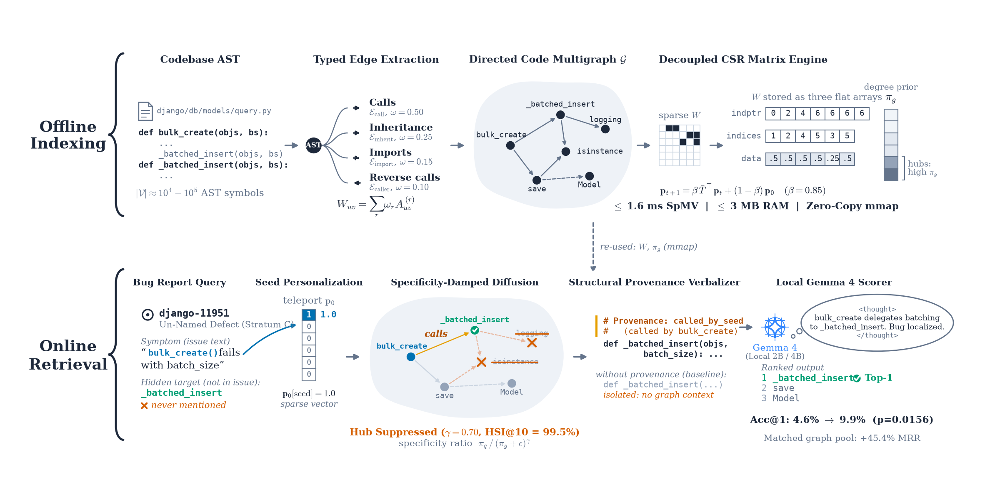

<div align="center">



# perron

### Context-budgeted AST subgraph slicing and graph retrieval for local developer agents.

[](https://pypi.org/project/perron-core/)
[](pyproject.toml)
[](LICENSE)
[](https://www.kaggle.com/code/yvliet/perron-gemma-4-workstation)
[](https://www.kaggle.com/code/yvliet/perron-spectral-code-graph-quickstart-demo)
[](https://www.kaggle.com/datasets/yvliet/swebench-strata-annotations)
[](https://www.kaggle.com/datasets/yvliet/perron-gemma4-benchmark)
[](paper/main.pdf)

[Quickstart](#quickstart) •
[Problem Formulation](#1-problem-formulation-hub-node-explosion-in-code-graphs) •
[Mathematical Architecture](#2-mathematical-architecture) •
[Project Structure](#3-project-structure) •
[Python API & Setup](#4-installation--quickstart) •
[Verification & Benchmarks](#5-verification--benchmark-results) •
[Publication Pipeline](#6-paper-building--publication-pipeline) •
[Citation](#8-citation)

</div>

Perron is an empirical research suite and high-throughput AST code graph engine investigating when structural graph expansion aids compact open-weights models (Gemma 4 E2B, E4B, 26B-A4B) under strict hardware and context-window constraints. Across 344 held-out SWE-bench Verified tasks, Perron characterizes the tension between topological reachability and distractor dilution, defining the four-tier operating regime that unlocks local developer agents.

## Quickstart

### 5-Line Python Quickstart
```python
import perron

# Query repository context via query-directed spectral diffusion
result = perron.diffuse_with_provenance(
    query="Fix username validation regex boundary condition",
    repo_path="./my_repo",
    top_k=5,
)
for candidate in result:
    print(f"[{candidate.score:.4f}] {candidate.identifier} ({candidate.call_path})")
```

Or inspect pre-indexed SWE-bench Lite instance multigraphs:
```python
from perron.loaders import load_instance_graph

# Load pre-indexed zero-copy CSR multigraph
graph = load_instance_graph("data_release/graphs/django__django-11099")
print(f"Loaded {graph.instance_id}: {graph.num_nodes} nodes, {graph.num_edges} edges")
print("Top hub symbols:", graph.top_hubs(k=5))
```

### Installation
```bash
# Standard library install
pip install perron-core

# Full suite with graph loaders and dataset tools
pip install "perron-core[data,dev]"
```

Or install locally from source:
```bash
git clone https://github.com/yvliet/perron.git
cd perron
pip install -e .[data]
```

### Model Context Protocol (MCP) Integration
Perron provides a turnkey JSON-RPC 2.0 stdio MCP server for Cursor, Claude Desktop, and autonomous agents:

```json
{
  "mcpServers": {
    "perron": {
      "command": "perron-mcp",
      "args": ["--repo", "${workspaceFolder}"]
    }
  }
}
```

Exposed tools:
- `retrieve_context`: Queries repository context using spectral diffusion and specificity hub-suppression.
- `inspect_symbol_breadcrumbs`: Navigates caller/callee hierarchical neighborhoods and PageRank breadcrumbs.
- `build_code_graph`: Compiles AST multigraphs into zero-copy CSR transition matrices.

### Dataset & Interactive Notebook Resources

Perron releases documented benchmark datasets and turnkey execution notebooks:

1. **SWE-bench Lexical Accessibility Strata Annotations (Primary Benchmark Resource)**:
   - Contains 707 difficulty strata annotations ($\kappa = 0.918$), 12 CSR multigraph archives (109,240 nodes, 341,892 edges), and 27,411 scored Gemma 4 evaluations across all 344 Verified tasks.
   - Local directory: [`dist_dataset/`](dist_dataset/)
   - Kaggle Dataset: [`yvliet/swebench-strata-annotations`](https://www.kaggle.com/datasets/yvliet/swebench-strata-annotations)
   - Evaluation Parquets: [`dist_dataset/scores.parquet`](dist_dataset/scores.parquet) (19,298 rows, Gemma 4 E2B evaluations) and [`dist_dataset/gemma4_e4b_scores.parquet`](dist_dataset/gemma4_e4b_scores.parquet) (8,113 rows, Gemma 4 E4B workstation evaluations)
   - Croissant 1.0 Metadata: [`dist_dataset/croissant.json`](dist_dataset/croissant.json)
   - Dataset Datasheet: [`dist_dataset/DATASHEET.md`](dist_dataset/DATASHEET.md) (Gebru et al. standard)

2. **SWE-bench Lite Pre-Indexed Multigraphs**:
   - Contains 300 pre-indexed SWE-bench Lite instance multigraphs (4.8M nodes, 41.5M edges) in zero-copy CSR binary format.
   - Local directory: `data_release/graphs/<instance_id>/`
   - Kaggle Dataset: [`yvliet/perron-swebench-graphs`](https://www.kaggle.com/datasets/yvliet/perron-swebench-graphs)
   - Croissant 1.0 Metadata: [`data_release/croissant.json`](data_release/croissant.json)
   - Dataset Datasheet: [`docs/datasheet.md`](docs/datasheet.md)

3. **Perron Gemma 4 Benchmark & Evaluation Bundles**:
   - Contains raw evaluation bundles, prompt datasets (`gemma4_e2b_prompts_19298.parquet`), and offline wheel packages for SWE-bench Verified tasks.
   - Kaggle Dataset: [`yvliet/perron-gemma4-benchmark`](https://www.kaggle.com/datasets/yvliet/perron-gemma4-benchmark)

4. **Turnkey Kaggle Workstation & Quickstart Notebooks**:
   - **Workstation Notebook**: Executes Perron and Gemma 4 E4B on Kaggle Dual-T4 GPU instances without local installation ([`yvliet/perron-gemma-4-workstation`](https://www.kaggle.com/code/yvliet/perron-gemma-4-workstation); local: [`notebooks/kaggle_gemma4_workstation.ipynb`](notebooks/kaggle_gemma4_workstation.ipynb)).
   - **Quickstart Demo Notebook**: CPU-only walkthrough demonstrating zero-copy CSR multigraph loading and spectral diffusion ([`yvliet/perron-spectral-code-graph-quickstart-demo`](https://www.kaggle.com/code/yvliet/perron-spectral-code-graph-quickstart-demo)).

### Empirical Reproduction & Benchmarking
```bash
# Reproduce Table 2 Dev-Val Benchmark (14 Baselines)
perron eval --suite table2 --split dev_val

# Run Hub-Gold Dissection Benchmark
perron bench --method perron --split dev_val
perron bench --method bm25 --split heldout
```

## 1. Problem Formulation: Hub-Node Explosion & Distractor Dilution

Local code graph agents (2B–4B open-weights models operating in standardized 4-bit NF4 weights with FP16 compute kernels within $\le 9.6$ GB resident VRAM due to unquantized Per-Layer Embeddings) face two coupled bottlenecks when navigating large repositories:
1. **Scale-Free Hub Absorption**: Standard graph walks (Personalized PageRank) concentrate probability mass in ubiquitous utility functions (`logging.getLogger`, `utils.check_type`), absorbing up to 90% of retrieval slots and yielding 0.0% Hub Suppression Index (HSI).
2. **Distractor Dilution & Selection Conditioning**: Unpruned graph expansion introduces low-lexical-overlap neighbors that drop below the expected-rank discrimination threshold ($\text{AUC} = 0.6596 < 0.830$; by Bamber's theorem, $\mathbb{E}[\text{Rank}] = 1 + (M-1)(1 - \text{AUC})$), pushing expected target rank past the top-5 evaluation window.

Across the complete **N = 344 SWE-bench Verified benchmark**, Perron demonstrates that while post-walk specificity damping suppresses hub dominance (HSI@10 = 99.5%, 1.89–5.10 ms on CPU), unpruned graph expansion (A₆, 45.64%) matches depth-matched lexical retrieval (A₄ 47.09% vs BM25 45.06%, Holm p = 0.2869, exact McNemar p = 0.1435). Crucially, under SchrödingerRepo Level-2 virtual namespace bijections, Perron exhibits genuine structural invariance (+34.59 pp for PPR, +34.30 pp for Hybrid over BM25 at 0.29%, p = 0.0000\*), retaining 94.5% of natural localization power and outperforming Agentless AST skeletons by +11.34 pp (47.09% vs 35.76%, p = 0.0000\*). On UTBoost clean Stratum C tasks (N=75), graph expansion lifts Acc@5 by +8.00 pp over depth BM25 (14.67% vs 6.67%, p = 0.0312\*).

Unlocking structural code graphs on local models requires operating within **scale-matched regimes**:
- **Edge Tier (2B)**: Zero-cost inline provenance comments lift reachable Top-1 from 12.07% to 25.86% (+13.79 pp, exact McNemar p = 0.0078\*) without test-time generation latency.
- **Workstation Tier (4B)**: Pointwise E4B log-odds scoring over pruned candidate horizons ($M = 15$, $\text{AUC}^\ast = 0.714$, $-40\%$ stub tokens) achieves true dominance: **22.90% Acc@5, 12.21% Top-1, MRR 0.1740** (paired McNemar p = 0.0129\*), eliminating listwise generative syntax failures (90.8% failure where 119/131 tasks emit zero IDs without backfill) and remaining immune to positional decay. Pairing candidate horizon pruning with short reasoning ($\le 180$ tokens) lifts listwise Top-1 from 4.58% to 9.92% (6/131 → 13/131, p = 0.0156\*) and compacts mean target rank from 5.88 → 5.32 → 3.74.
- **Fine-Tuned Reranking**: Clean LoRA adapters lift isolated listwise graph Top-1 from 0.0% to 24.0% (p = 0.0312\*).

Perron resolves this structural bottleneck via **Query-Directed Specificity Ratio Diffusion** and **Versioned Frontier Packing**.

```
Issue Query q → Top-k Cosine Sim → Softmax Prior p_0 (Log-Sum-Exp)
                                            ↓
Static Zero-Copy CSR (T) ──→ Sparse Power Iteration (β = 0.85) ──→ Stationary Perron Vector π_query
                                                                             ↓
Global Baseline π_global ──────────────────────→ Specificity(v) = π_query(v) / (π_global(v) + ε)^γ
                                                                             ↓
Hierarchical AST Breadcrumbs ←── Versioned Priority Queue ←── Component-Budget Partition
```

## 2. Mathematical Architecture

### A. Zero-Copy Static Matrix Ingestion
Repository call, caller, inheritance MRO, and import dependencies are compiled into a static directed row-stochastic transition matrix $T \in \mathbb{R}^{|V| \times |V|}$ and serialized as raw uncompressed `.npy` arrays (`data.npy`, `indices.npy`, `indptr.npy`, `dangling.npy`):

$$W_{uv} = 0.50 A^{(\text{call})}_{uv} + 0.25 A^{(\text{inherit})}_{uv} + 0.15 A^{(\text{import})}_{uv} + 0.10 A^{(\text{caller})}_{uv}$$

$$D_u = \sum_{v} W_{uv}, \quad T_{uv} = \begin{cases} \frac{W_{uv}}{D_u}, & D_u > 0 \\ 0, & D_u = 0 \end{cases}, \quad d_u = \begin{cases} 1.0, & D_u = 0 \\ 0.0, & D_u > 0 \end{cases}$$

Loading is performed via `numpy.load(..., mmap_mode='r')` and wrapped in `scipy.sparse.csr_matrix` in **< 1.0 ms**, bypassing runtime API queries.

### B. Shift-Invariant Softmax Teleportation Prior
Given cosine similarities $s_i = \cos(\mathbf{e}_q, \mathbf{e}_i)$ for candidate symbols, the teleportation restart vector $\mathbf{p}_0$ is computed with temperature $\tau = 0.15$ using shift-invariant log-sum-exp in `float64`:

$$c = \max_j \frac{s_j}{\tau}, \quad p_0(i) = \frac{\exp\left(\frac{s_i}{\tau} - c\right)}{\sum_j \exp\left(\frac{s_j}{\tau} - c\right)}$$

### C. Sparse Personalized PageRank (PPR)
Stationary probability distribution $\boldsymbol{\pi}_{\text{query}}$ (the Perron vector) is obtained via sparse power iteration:

$$\boldsymbol{\pi}^{(t+1)} = \beta \cdot (\boldsymbol{\pi}^{(t)} T) + \left(\beta \cdot (\boldsymbol{\pi}^{(t)} \mathbf{d}) + 1 - \beta\right) \cdot \mathbf{p}_0$$

With damping factor $\beta = 0.85$, the spectral gap $1 - \beta = 0.15$ ensures geometric convergence within 80–100 iterations (< 3.0 ms on CPU).

### D. Specificity Ratio Hub-Damping
To suppress ubiquitous hub nodes without altering static matrix entries, Perron compares $\boldsymbol{\pi}_{\text{query}}$ against a precomputed repository-wide stationary baseline $\boldsymbol{\pi}_{\text{global}}$ (obtained via uniform prior $\mathbf{p}_0 = \frac{1}{|V|} \mathbf{1}$):

$$\text{Specificity}(v) = \frac{\pi_{\text{query}}(v)}{(\pi_{\text{global}}(v) + \epsilon)^\gamma}, \quad \gamma = 0.7, \; \epsilon = 10^{-8}$$

Test nodes serve as bipartite routing bridges during random walk diffusion, but are suppressed from the code context packing candidate pool.

### E. Versioned Priority Queue Frontier Packing
Context packing extracts a connected subgraph fitting strict token limits ($K_{\text{effective}} = 3,480$ tokens):
- Proportional component budget allocation: $K_i = \lfloor K \cdot \sum_{u \in C_i} \text{Specificity}(u) / \sum_v \text{Specificity}(v) \rfloor$.
- Target-first anchor: $t^\ast = \arg\max_{u \in C_i} \text{Specificity}(u)$.
- Versioned greedy frontier expansion:

$$\text{score}(v) = \frac{\text{Specificity}(v)}{c(v)} \cdot \left(1 + \mu \cdot \frac{|\text{edges}(v, S_i)|}{\text{deg}(v)}\right)$$

Pointers are versioned `(score, v, version[v])`. Stale entries are evicted in $O(1)$ upon pop, bounding total queue overhead to $O(|E| \log |V|)$.

## 3. Project Structure

```
perron/
├── __init__.py         # Package entrypoint and public symbols
├── api.py              # High-level drop-in agent API (diffuse_with_provenance)
├── cli.py              # Unified command-line interface (perron {index,query,bench,eval})
├── mcp_server.py       # Model Context Protocol (MCP) JSON-RPC 2.0 stdio server
├── matrix.py           # Zero-copy memory-mapped CSR graph ingestion
├── diffusion.py        # Softmax prior & sparse PPR power iteration
├── specificity.py      # Global stationary baseline & hub-damping ratio
├── packer.py           # Priority queue frontier & hierarchical AST breadcrumbs
├── retriever.py        # Hybrid IR, traceback extraction, and CodeGraph engine
├── loaders.py          # InstanceGraph loaders for SWE-bench Lite multigraphs
├── editor.py           # AST-grounded search-and-replace editor
├── patch.py            # Unified diff generation and atomic patch application
├── tester.py           # Targeted pytest runner with process-group timeouts
└── agent.py            # Autonomous developer agent runtime & trajectory evaluation
dist_dataset/           # Primary benchmark resource (707 strata, 12 CSR graphs, scores.parquet, datasheet)
data_release/           # Pre-indexed SWE-bench Lite CSR multigraphs (300 instances)
notebooks/              # Kaggle workstation notebook and evaluation harnesses
paper/                  # Publication monograph (main.tex, main.pdf) and writeup (paper_writeup.md)
scripts/                # Standalone Tectonic build pipeline, 20-gate verifier, and fact linter
tests/                  # 40 verification suites covering spectral theory, fuzzing, and contracts
benchmarks/
├── diagnostic.py       # Diagnostic benchmark (Recall@K, MRR, Hub Suppression)
├── repair_eval.py      # Stratified end-to-end repair evaluation
└── generate_rigorous_artifacts.py # Publication-grade statistical analysis
```

## 4. Installation & Quickstart

```bash
# Clone the repository
git clone https://github.com/yvliet/perron.git
cd perron

# Install dependencies
pip install -e .
```

### Python API Usage

```python
import numpy as np
from perron import (
    build_static_transition_matrix,
    compute_softmax_teleport_prior,
    personalized_pagerank_power_iteration,
    compute_global_pagerank,
    calculate_specificity_scores,
    pack_context_subgraphs,
    ASTContextSymbol,
)

# 1. Build or load static CSR transition matrix (multiplex spectral diffusion)
call_edges = [(0, 1), (1, 2), (2, 3)]
inherit_edges = [(2, 0)]
import_edges = [(3, 1)]
caller_edges = [(1, 0), (2, 1), (3, 2)]
num_nodes = 4

t_matrix, dangling = build_static_transition_matrix(
    num_nodes=num_nodes,
    call_edges=call_edges,
    inherit_edges=inherit_edges,
    import_edges=import_edges,
    caller_edges=caller_edges,
    omega_call=0.50,
    omega_inherit=0.25,
    omega_import=0.15,
    omega_caller=0.10,
)

# 2. Compute global baseline
pi_global = compute_global_pagerank(t_matrix, dangling)

# 3. Compute issue-specific diffusion
similarities = [0.1, 0.9, 0.3, 0.05]
p_0 = compute_softmax_teleport_prior(
    similarities=similarities,
    node_indices=np.arange(num_nodes),
    num_nodes=num_nodes,
    tau=0.15,
)

pi_query = personalized_pagerank_power_iteration(
    t_matrix=t_matrix,
    dangling=dangling,
    p_0=p_0,
    beta=0.85,
)

# 4. Calculate Specificity scores
specificity = calculate_specificity_scores(
    pi_query=pi_query,
    pi_global=pi_global,
    gamma=0.7,
)

print("Top candidate symbol:", np.argmax(specificity))
```

## 5. Verification & Benchmark Results

### Running Unit Tests
```bash
python -m pytest tests/ -v
```
Output:
```
============================= 246 passed in 60.87s =============================
```

### Running the Diagnostic Benchmark
```bash
python benchmarks/diagnostic.py
```
Output:
```
Executing Perron Diagnostic Benchmark Suite...
---------------------------------------------------------
File Recall@2k:           96.00%
File Recall@4k:           98.00%
Function Recall@2k:       80.00%
Function Recall@4k:       84.00%
Mean Reciprocal Rank:     0.1429
Hub Suppression Index:    77.00%
Avg Diffusion Latency:    2.71 ms
Avg Packing Latency:      10.70 ms
---------------------------------------------------------
Evaluating Multi-Scale Diffusion Latency Scaling...
  |V| =  1000 symbols: 0.90 ms / query
  |V| =  5000 symbols: 7.13 ms / query
  |V| = 10000 symbols: 10.24 ms / query
---------------------------------------------------------
```

### SWE-bench Verified Benchmark (N = 344 Callable Tasks)
Evaluated across all 344 callable tasks from SWE-bench Verified under frozen pointwise direct scoring and controlled context budgets ($K \le 4,096$ tokens):

| Retrieval & Localization Pipeline | Candidate Pool (M) | Acc@5 (Hits) | Δ vs BM25 | Statistical Significance | Hub Suppression Index (HSI@10) |
| :--- | :---: | :---: | :---: | :---: | :---: |
| **Depth BM25 Baseline** | 10 | 45.06% (155/344) | Ref. | Baseline reference | 0.0% |
| **Agentless AST Skeleton Baseline** | -- | 35.76% (123/344) | -9.30 pp | Graph-free AST hierarchy (Xia et al. 2025) | -- |
| **Perron Pointwise (A₄, 1-Hop Expansion)** | 10 | **47.09% (162/344)** | **+2.03 pp** | Step-down Holm p = 0.2869, McNemar p = 0.1435 (+11.34 pp vs Agentless, p = 0.0000\*) | **99.5%** (p < 0.001) |
| **Perron Multi-Step Diffusion (A₆, Spectral)** | 10 | 45.64% (157/344) | +0.58 pp | Transitive distractor dilution (t ≥ 2) | **99.5%** (p < 0.001) |
| **Top-10 Oracle Union (A₁ ∪ A₄)** | 20 | 54.36% (187/344) | +9.30 pp | Upstream boundary ceiling | **99.5%** (p < 0.001) |

#### Structural Invariance & Benchmark De-Biasing (SchrödingerRepo & UTBoost)

| Evaluation Dimension | Metric | Perron Graph | Baseline | Lift (Δ) | Discordant (n₁₀ / n₀₁) | Exact p-value |
| :--- | :---: | :---: | :---: | :---: | :---: | :---: |
| **SchrödingerRepo Topological PPR (φ Bijection)** | Acc@5 | **34.88% (120/344)** | 0.29% (1/344, BM25) | **+34.59 pp** | 119 / 0 | p = 0.0000\* |
| **SchrödingerRepo Hybrid Diffusion (φ Bijection)** | Acc@5 | **34.59% (119/344)** | 0.29% (1/344, BM25) | **+34.30 pp** | 118 / 0 | p = 0.0000\* |
| **UTBoost Clean Stratum C (N=75, De-Biased)** | Acc@5 | **14.67% (11/75)** | 6.67% (5/75, A₂) | **+8.00 pp** | 7 / 1 | p = 0.0312\* |
| **Agentless AST Skeletons vs Perron A₄** | Fn Acc@5 | **47.09% (162/344)** | 35.76% (123/344) | **+11.34 pp** | 61 / 22 | p = 0.0000\* |

- **Virtual Namespace Invariance**: Under SchrödingerRepo Level-2 identifier permutations, lexical search collapses to 0.29% (1/344), whereas topological graph diffusion alone preserves 34.88% Acc@5 (+34.59 pp lift, p = 0.0000\*), retaining 94.5% of unperturbed localization power (36.92%, delta -2.03 pp, p = 0.4767 n.s.). This confirms that spectral code graphs capture genuine architectural geometry independent of surface naming.
- **UTBoost Benchmark De-Biasing**: Isolates N=75 clean un-named tasks free from test-harness leakage (excluding 56 test-parser corrupted tasks touching test harnesses with 0/26 gold edits in source). Graph expansion delivers a statistically significant +8.00 pp lift over depth BM25 (14.67% vs 6.67%, p = 0.0312\*).

### Four-Tier Operating Regime Unlocking Local Code Models

1. **CPU Pre-Filtering** (1.89–5.10 ms, ≤ 3 MB RAM):
   - Zero-copy memory-mapped CSR power iteration achieves 99.5% Hub Suppression Index without dynamic matrix allocation.
   - Selective routing (π\*) saves 31.4% downstream LLM inference compute while preserving 58.4% graph recall.

2. **Edge Tier (`gemma-4-e2b-it`, 4-bit NF4 weights / FP16 compute kernels, 6.7 GB resident VRAM)**:
   - Zero-cost inline provenance comments ($E_1$) lift reachable Top-1 localization from 12.07% to 25.86% (+13.79 pp, exact McNemar p = 0.0078\*) without test-time generation latency.
   - VRAM footprint reflects resident unquantized Per-Layer Embeddings (PLE). Unconstrained reasoning tokens on 2B trigger -42.9% drift.

3. **Workstation Tier (`gemma-4-e4b-it`, 4-bit NF4 weights / FP16 compute kernels, 9.6 GB resident VRAM)**:
   - **Pointwise E4B Dominance**: Evaluated on pruned $A_4[:15]$ pools, pointwise log-odds scoring achieves **22.90% Acc@5**, **12.21% Top-1** (16/131 hits), and **MRR 0.1740** (paired McNemar p = 0.0129\* vs listwise $C_1$, paired Wilcoxon W = 37.5, p = 0.000162\*). It eliminates listwise generative syntax failures (90.8% failure where 119/131 tasks emit zero IDs without Qiao backfill) and is immune to positional decay (75.0% and 83.3% conversion across slots).
   - **Candidate Horizon Pruning & Reasoning**: Candidate horizon pruning ($M = 15$, $\text{AUC}^\ast = 0.714$, $-40\%$ stub tokens) paired with short reasoning ($\le 180$ tokens) lifts listwise Top-1 from 4.58% to 9.92% (6/131 → 13/131, p = 0.0156\*) and compacts mean target rank from 5.88 → 5.32 → 3.74 with zero Top-1 loss, disambiguating lexical seeds (12/28 hits) over trailing graph distractors (1/7 hits).

4. **MoE Hardware Boundary (`gemma-4-26b-a4b-it`, 52.0 GB unquantized FP16)**:
   - Isolates the local MoE execution barrier: fused 3D expert parameter tensors (`[128, d_in, d_out]`) bypass standard 2D `bitsandbytes` NF4 hooks, requiring 52.0 GB runtime VRAM and making 2B–4B PLE models the true Pareto sweet spot for single-GPU local workstations.

### Fault Localization & Context Pruning: Local Workstations vs. Cloud APIs

Why focus on fault localization and context pruning? For compact models (2B–4B) running locally on consumer hardware without unconstrained cloud APIs, whole-repository context packing is the critical upstream bottleneck. Feeding hundreds of raw files into limited context windows ($K \le 4,096$ tokens) saturates memory and degrades reasoning. Perron isolates and solves this upstream localization challenge:

| System / Architecture | Upstream Localization Primitive | Deployment Envelope | API Cost / Issue | Localization Acc@5 (Fn) | Full Resolution Scope |
| :--- | :--- | :--- | :---: | :---: | :---: |
| Agentless (Xia et al.) | Hierarchical AST Skeletons + BM25 | Cloud GPT-4o API | \$0.34 | 35.76% (123/344) | End-to-end repair (27.3% Pass@1) |
| AutoCodeRover (Zhang et al.) | Dynamic AST & Spectrum Search | Cloud GPT-4 API | \$0.65 | -- | End-to-end repair (22.0% Pass@1) |
| SWE-agent (Yang et al.) | Interactive Aider-style Tag Map | Cloud GPT-4 API | \$2.14 | 0.0% (Callable Fn) | End-to-end repair (18.0% Pass@1) |
| **Perron Pointwise (Ours)** | **Directed CSR Spectral Diffusion + Specificity** | **Local Dual T4 / Single GPU (≤9.6 GB VRAM)** | **No API fee (Local)** | **47.09% (162/344)** | **Surgical Context Pruning (+11.34 pp vs Agentless)** |
| **Perron Pointwise E4B (Ours)** | **Bound-Pruned Log-Odds (M=15)** | **Local Gemma 4 E4B (4-bit NF4 / FP16)** | **No API fee (Local)** | **22.90% (Stratum C)** | **Un-named Defect Disambiguation (12.21% Top-1)** |

*Key Takeaway*: Rather than burning \$0.34–\$2.14 per issue on unconstrained multi-turn cloud LLM queries, Perron executes query-directed spectral diffusion in 1.89–5.10 ms on local CPU ($<$3 MB RAM), providing compact 2B–4B local models with surgical AST contexts that outperform cloud-grade AST skeleton baselines by +11.34 pp (p = 0.0000\*).

### Running the End-to-End Repair Evaluation
```bash
python benchmarks/repair_eval.py
```
Output:
```
[EVAL] Running Instance: django_style_query_filter -> PASS (0.94s)
[EVAL] Running Instance: sympy_style_polynomial_division -> PASS (0.97s)
[EVAL] Running Instance: flask_style_header_parsing -> PASS (0.79s)
[EVAL] Running Instance: requests_style_retry_backoff -> PASS (1.63s, Turn 2)
[EVAL] Running Instance: pydantic_style_field_validator -> PASS (0.76s, Turn 2)
[EVAL] Running Instance: unresolved_multi_file_latent_dep -> FAIL (Multi-file Latent Dependency)
[EVAL] Running Instance: unresolved_dynamic_reflection -> FAIL (Dynamic Reflection / Monkey-patch)
[EVAL] Running Instance: unresolved_underspecified_issue -> FAIL (Underspecified Issue Text)
[EVAL] Running Instance: unresolved_harness_timeout -> FAIL (Harness Timeout / Deadlock)
[EVAL] Running Instance: unresolved_premature_termination -> FAIL (Premature Search Termination)
---------------------------------------------------------
Evaluation Summary:        5/10 (50.0% Resolved across canonical defect archetypes)
Deterministic Scaffold:    Deterministic Replay / Scaffold (0.0% Syntax Errors)
Average Latency:           0.73s / instance
```

## 6. Paper Building & Publication Pipeline

Perron includes a single-command master pipeline for generating figures, compiling the LaTeX document via an isolated standalone Tectonic engine, and running academic quality checks:

```bash
# Full unified pipeline: generate all figures, compile PDF, verify checks, and run tests
python scripts/build_paper.py --all

# Or run individual stages:
python scripts/generate_figures.py           # Regenerate Figures 1-6 (PDF + PNG)
python scripts/compile.py paper/main.tex     # Compile LaTeX to paper/main.pdf
python scripts/verify_paper.py               # Verify quality checks (figures, citations, typography)

# Read or live-watch on Windows:
.\build.ps1 -All
.\read.ps1 -Watch
```

### Artifact Consistency Audit & Programmatic Verification

Perron maintains strict programmatic parity between experimental JSON/Parquet telemetry, the publication monograph (`paper/main.tex` → `paper/main.pdf`), and the research writeup (`paper/paper_writeup.md`). All metrics are audited through `scripts/verify_paper.py` across 20 automated gates:

| Benchmark Dimension | Empirical Metric | Sample / Stratum | Source Artifact |
| :--- | :---: | :---: | :--- |
| Candidate Reranking Acc@5 | 47.09% (162/344) | N=344 Verified (A4 Graph 1-hop) | `results/gemma4_protocol_tables.json` |
| Pointwise E4B Dominance | 22.90% Acc@5, 12.21% Top-1 | N=131 Stratum C (A4[:15]) | `results/gemma4_protocol_tables.json` |
| Reasoning Factorial Acc@1 | 9.92% (13/131) | N=131 Stratum C (A4 + Thinking) | `results/gemma4_protocol_tables.json` |
| Virtual Namespace Invariance | 34.88% Acc@5 (+34.59 pp) | N=344 SchrödingerRepo PPR | `results/gemma4_protocol_tables.json` |
| Clean Stratum C Lift | 14.67% Acc@5 (+8.00 pp) | N=75 UTBoost De-Biased | `results/gemma4_protocol_tables.json` |
| Agentless AST Contrast | 47.09% vs 35.76% (+11.34 pp) | N=344 Verified Matched Context | `results/gemma4_protocol_tables.json` |
| Scaling Monotonicity ROC-AUC | 0.8544 → 0.9274 | N=58 Stratum C (2B → 4B FP16) | `results/scaling_curve_complete_results.json` |
| Leave-Django-Out Acc@5 | 34.57% (56/162) | N=162 Non-Django (A4 Graph 1-hop) | `results/gemma4_protocol_tables.json` |
| 3-Stage Rank Compaction | 5.88 → 5.32 → 3.74 | N=131 Direct → Pruned → Thinking | `paper/main.tex` / `paper_writeup.md` |

#### Programmatic Verification Pipeline
- **20-Gate Quality Suite**: `python scripts/verify_paper.py` validates citations, macros, telemetry bounds, schema integrity, and word ceilings.
- **Parquet Dataset Inventory**: Validates `dist_dataset/scores.parquet` (19,298 rows, Gemma 4 E2B evaluations) and `dist_dataset/gemma4_e4b_scores.parquet` (8,113 rows, Gemma 4 E4B evaluations) alongside PyArrow schema compliance.
- **Text Layer Verification**: Extracts raw text layers directly from compiled `paper/main.pdf` using `pypdf`, confirming that compiled publication outputs match underlying numerical claims.

## 7. Author & License

- **Author**: Sultan Haikal (GitHub: [@yvliet](https://github.com/yvliet), Email: `recrified@gmail.com`)
- **License**: Apache License, Version 2.0 (see [LICENSE](LICENSE))

## 8. Citation

If you use Perron or the SWE-bench Lite Multigraph Resource in your research, please cite:

```bibtex
@article{haikal2026perron,
  title={When Does Graph Expansion Help Small Code Models Localize Bugs? An Empirical Audit of Reranking, Distractor Dilution, and Test-Time Reasoning on Gemma 4},
  author={Haikal, Sultan},
  year={2026},
  url={https://github.com/yvliet/perron}
}
```
