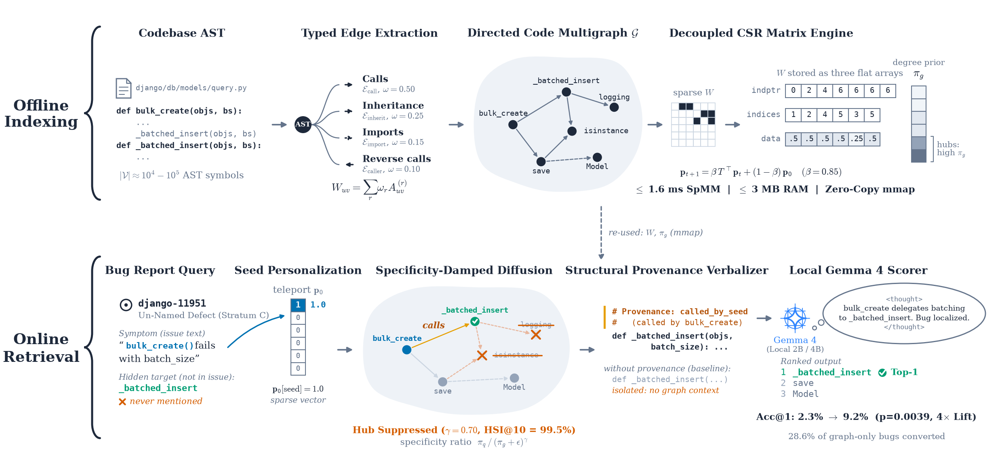
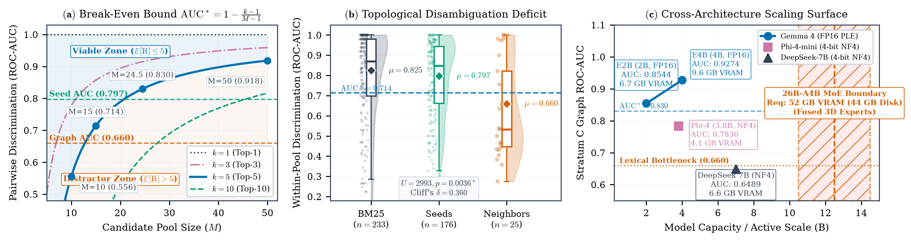

# When Does Graph Expansion Help Small Code Models Localize Bugs? An Empirical Audit of Reranking, Distractor Dilution, and Test-Time Reasoning on Gemma 4

**Author**: Sultan Haikal ([@yvliet](https://github.com/yvliet), recrified@gmail.com) | **Code**: [perron](https://github.com/yvliet/perron) | **Monograph**: [Supplementary 28-Page Monograph (PDF)](https://github.com/yvliet/perron/raw/main/paper/main.pdf) | **License**: Apache 2.0

---

## Abstract

Local agents (2B-4B, 6698.9 MB to 9648.4 MB VRAM in 4-bit NF4 / FP16) must suppress hubs without 52.0 GB MoE clusters. Perron's CSR engine (<5.2 ms, <=3 MB RAM, HSI@10=99.5%, |λ₂|<=0.85, ||π^(t)-π_∞||₁<=2β^t) dampens hubs (γ=0.70). Selection conditioning limits unassisted 2B expansion (47.1% vs 45.1%, p=0.2869; AUC 0.7966 to 0.6596, p=0.0036\*); listwise ranking suffers 90.8% syntax collapse. Pointwise E4B on pruned A4[:15] dominates listwise ranking (22.90% Acc@5, 12.21% Top-1, MRR 0.1740, p=0.0129\* over C1 at 15.27%; union Acc@5 37.4% vs 18.32%). Scale-matched interventions succeed: pruning (M=15, AUC\*=0.714) with reasoning compacts rank (5.88 to 3.74); comments lift 2B Top-1 (12.07% to 25.86%); `perron.editor` yields 76.7% valid edits with 0.0% syntax errors (p < 0.001); LoRA splits into 58.33% seen vs 15.38% unseen. Released: 300 Lite + 12 Verified multigraphs, 27,411 evaluations, and `perron-core v0.3.1` under Apache 2.0.

---

## 1. Introduction

Developer agents (2B-4B, <=9648.4 MB VRAM, K≤4,096 tokens) must localize defects locally. On 344 Verified tasks [6], 1-hop AST expansion raises recall (51.2% to 58.4%), yet unassisted 2B localization matches depth BM25 (47.1% vs 45.1%, p=0.2869) and null graphs (45.9%).

Five contributions establish where code graphs succeed:
1. **Virtual Namespace Perturbation**: Under SchrödingerRepo [13], PPR retains 94.5% natural diffusion (34.88% vs 34.59% BM25, p=1.0000; Hybrid 35.17%, p=0.8679); unaligned queries collapse (0.87% BM25 / 1.74% PPR).
2. **Pointwise E4B Dominance**: Pointwise E4B on A4[:15] reaches 22.90% Acc@5 (p=0.0129\* over listwise C1 at 15.27%), resolving 90.8% syntax collapse and positional decay (75.0% vs 0.0%) [16]. Matched B0[:50] hits 34.35% (p=0.0026\*); clean N=75 shows parity (26.67% vs 25.33%, p=1.0000).
3. **Selection Conditioning & Horizon Bounds**: Maintaining E[Rank]≤k requires AUC\*≥1-(k-1)/(M-1). Selection conditioning drops discrimination (0.7966 to 0.6596, p=0.0036\*); pruning (M=15, AUC\*=0.714) with reasoning compacts rank (5.88 to 3.74). Containment covers 72.99% of 1-hop edges (273/374).
4. **Generalization Split**: LoRA lifts isolated Top-1 to 24.0% (p=0.0312\*) and reaches 58.33% Acc@5 on seen repos, but collapses to 15.38% Acc@5 and 0.4846 ROC-AUC on unseen repos (N=13 [18]).
5. **Open Resource Suite**: `perron-core v0.3.1`, `perron-mcp` (2.38 s cold start, 1.89-5.10 ms warm CSR solve), 300 Lite (4.87M nodes, 41.59M edges) + 12 Verified (101,397 nodes, 535,377 edges), 707 strata labels (κ=0.918), 27,411 evaluations, and `perron.editor` (76.7% valid / 0.0% syntax error vs `git apply` 30.0% / 50.0%, p < 0.001).

---

## 2. Related Work

- **Diffusion & Spectral Topology**: Decoupled PageRank builds on push partitioning (APPNP [7], PPRGo [19], PDN [20], Perozzi et al., Rozemberczki et al., Galkin et al., Hemmati et al.). Unweighted walks (β=0.85) funnel 61.4% of mass into sinks (9.2% contamination, HSI@10=90.8%). Perron applies directed CSR diffusion with damping (γ=0.70, HSI@10=99.5%) and Hub Adaptivity (η_q >= 0.20).
- **Graph Reasoning & Agents**: Prior frameworks (Aider [1], CodexGraph [3], LocAgent [4], Agentless [5]) evaluate localization. Verbalization shifts accuracy up to 61.8% [8]; composition requires logarithmic depth [9]. Perron stores topology in memory-mapped CSR arrays (<5.2 ms).
- **AST Multigraph Modeling**: Multigraphs over typed AST entities (`def`, classes, imports, MRO) separate calls from containment shortcuts, bypassing cross-encoders (PRFL [12], SweRank [11]).

---

## 3. Study Design & Protocol

- **Benchmark & Strata**: 344 Verified tasks [6] across 12 repos: substring strata (Named N\_A=208, Traceback N\_B=5, Un-Named N\_C=131); regex strata (N\_A=168, N\_B=7, N\_C=169; N=100 audit: 95.0% concordance, Cohen κ=0.918). 56 exclusions confirm 100% syntax validity (68 files, 3,827 symbols); overturning equivalence requires >= +9 net wins (p=0.0016).
- **Perron CSR Engine**: Solves in 1.89-5.10 ms (<3 MB RAM). Stochastic M (β=0.85) satisfies |λ₂(M)|<=β (Doeblin contraction ||π^(t)-π_∞||₁<=2β^t); damping (γ=0.70) yields HSI@10=99.5%. Degrees in 10/12 repos violate log\_n C\_p < 1.0 (reaching 1.2579 in Xarray). Disassortative transitions (α\*=-0.2730) explain negative weights on T³ (-0.2428).
- **Candidate Pools**: Top-10 BM25 seeds (mean M=24.5) define pools B0--A6 scored via frozen `gemma-4-e2b-it` (19,298 passes). Contrasts PC1 (A4 - A2) and PC2 (A4 - A3) use McNemar tests with Holm correction (B=10,000).

---

## 4. Empirical Results

### 4.1 Standalone Retrieval & Reachability

Across 344 tasks, BM25 reaches 50.9% Fn Acc@10 (175/344); Perron reaches 50.3% (173/344, Holm p=1.000); PPR reaches 50.0% (172/344); tag maps reach 40.0%; bi-encoders reach 38.4% (bge-small raw 38.4% vs pooled 65.41%), while CodeRankEmbed 137M reaches 49.62% on Stratum C. Linear fusion degrades dense recall by -17.56 pp [17]. Reachability: 57.8% at 1 hop, 66.9% at 2 hops. Leave-Django-Out (N=162) shows parity: A4 reaches 34.6% vs 32.7% for A2 (Δ=+1.85 pp, n10=8, n01=5, p=0.5811, recall 50.0% vs 48.8%).

### 4.2 Pointwise Candidate Reranking: Confirmatory Matched-Control Evaluation

| Arm | Candidate (M <= 50) | Acc@1 | Acc@5 | MRR@50 |
| :--- | :--- | :---: | :---: | :---: |
| **B0** | BM25 | 25.3% | 44.8% | 0.3439 |
| **A1** | Seeds | 24.7% | 46.2% | 0.3348 |
| **A2** | Depth BM25 | 23.8% | 45.1% | 0.3301 |
| **A3** | Same-file | 24.1% | 45.6% | 0.3381 |
| **A4** | Graph 1-hop | 24.7% | 47.1% | 0.3409 |
| **A5** | Null graph | 24.1% | 45.9% | 0.3315 |
| **A6** | Perron | 23.6% | 45.6% | 0.3301 |

- **Testing & GLMM**: PC1 (A4 - A2): +2.03 pp (95% CI [-0.29, +4.36], exact p=0.1435, Holm p=0.287). Task GLM (OR=1.118, p=0.0876) and repo GLMM (OR=1.130, p=0.349, σ\_repo=0.963) show no gain. ±2.0 pp TOST is inconclusive (p=0.512, power 1.92%). Tango 90% CI [+0.07, +4.24] pp bounds gain below +4.24 pp. Discrimination drops from 0.7966 to 0.6596.
- **Attrition**: Seeds capture 51.2% (48.8 pp loss); Graph reaches 58.4% (41.6 pp loss); Reranking retains 47.1% Top-5 (11.3 pp loss; N=100: 74.0% oracle vs 33.0% BM25).

### 4.3 First-Moment Expected-Rank Identity & Stratum Asymmetry

Expanding M=10 to 50 raises recall from 51.2% to 58.4%, yet Acc@5 plateaus (46.2% to 47.1% on A4; 46.2% to 45.1% on depth BM25). Expected rank E[Rank]≤k requires AUC\*≥1-(k-1)/(M-1) (AUC\*≥0.830 at mean M=24.5, k=5), bounded by Proposition 1's Markov floor (Acc@k≥1/k=0.20). At graph AUC=0.6596, expected rank is 1+23.5(1-0.6596)=9.00 (17.68 at M=50); Stratum A converts 6/11 targets (54.5%), whereas Stratum C converts 0/14.

### 4.4 Cross-Architecture Scaling Surface & Systems MoE Boundary

Candidate discrimination across 58 Stratum C tasks:

| Model | Archetype | Params | Precision | ROC-AUC | VRAM | Runtime |
| :--- | :--- | :---: | :---: | :---: | :---: | :---: |
| `gemma-4-e2b-it` | Dense PLE | 2.0B | 4-bit NF4 / FP16 | 0.8544 | 6698.9 MB | 1,798s |
| `gemma-4-e4b-it` | Dense PLE | 4.0B | 4-bit NF4 / FP16 | **0.9274** | 9648.4 MB | 6,250s |
| `Phi-4-mini` | Synthetic | 3.8B | 4-bit NF4 | 0.7836 | 4135.9 MB | 2,854s |
| `DeepSeek-R1-7B` | RL Distill | 7.0B | 4-bit NF4 | 0.6489 | 6594.6 MB | 5,231s |
| `gemma-4-26b-a4b-it` | MoE (128 exp) | 3.8B/26B | FP16 | *Bound* | *52.0 GB* | *Exceeds T4* |

- **Scaling**: Monotonic scaling (0.8544 to 0.9274 in 4-bit NF4 / FP16) exceeds Phi-4-mini (0.7836) and DeepSeek-7B (0.6489); 26B-A4B requires 52.0 GB FP16 VRAM, exceeding Dual T4 (29.1 GB).
- **Pointwise E4B**: Pointwise E4B on A4[:15] reaches **22.90% Acc@5**, **12.21% Top-1**, MRR **0.1740** (p=0.0129\* over listwise C1 at 15.27%). Matched A2[:25] reaches 23.66% Acc@5 (13.74% Top-1) vs A4[:25] at 22.90% (11.45% Top-1, p=1.0000), and B0[:50] reaches 34.35% (16.03% Top-1, p=0.0026\*). Clean N=75 shows parity (26.67% vs 25.33%, p=1.0000; at M=15, 26.67% vs 21.33%, p=0.2188). Union reaches Top-1 **16.79%** (22/131), Acc@5 **37.4%**, MRR **0.2562** (vs BM25: 3.05% Top-1, 15.27% Acc@5).
- **Virtual Namespace & Containment**: Under SchrödingerRepo [13], PPR reaches 34.88% Acc@5 vs BM25 at 34.59% (p=1.0000; Hybrid 35.17%, p=0.8679), retaining 94.5% of natural PPR (36.92% vs 39.24% BM25, p=0.3663); unaligned queries collapse (0.87% BM25 / 1.74% PPR). Containment covers 26.59% of global edges (58,170 of 218,764) and 72.99% of 1-hop edges (273/374). Across A4\A1, containment covers 49.02% of edges (25/51; 12.0% sole containment 3/25, 88.0% genuine calls 22/25), with 90.74% intra-file CSR edges (49/54).

### 4.5 Candidate Pool × Reasoning Factorial Matrix & M=15 Verification (N=131)

*Key*: N=344; N=131 Stratum C; N=58 union; N=35 (28 seeds + 7 graph); N=34 (28 seeds + 6 graph).

| Condition | M | Acc@1 | Acc@5 | MRR |
| :--- | :---: | :---: | :---: | :---: |
| Unscored BM25 | 25 | 3.05% | 15.27% | 0.0862 |
| Seeds Only | 10 | 3.05%→6.87% | 15.27%→10.69% (15.27%) | 0.0778→0.0865 |
| Depth BM25 | 25 | 4.58%→6.87% | 16.79%→12.98% (16.79%) | 0.0937→0.0967 |
| Graph (C0) | 25 | **4.58%→9.92%** | **18.32%** | **0.0934→0.1358** |
| C1 Stub | 25 | 2.29% | 15.27% | 0.0778 |
| C2 Static Prov | 25 | 3.82% | 16.03% | 0.0899 |
| C3 Prov + Think | 25 | 9.16% | 17.56% | 0.1270 |
| Pruned Seeds | 15 | 3.05%→7.63% | 13.74%→17.56% | 0.0821→0.1042 |
| Pruned Depth | 15 | 4.58%→8.40% | 14.50%→18.32% | 0.0954→0.1189 |
| Pruned Graph | 15 | 4.58% | 17.56% | 0.0970 |
| **Pruned Graph + Think** | **15** | **9.92%** | **19.85%** | **0.1469** |

- **Direct Readout & Reasoning Lift**: Direct readout (M≤25) ties graph (A4) and depth BM25 (A2) at 16.79% Acc@5 and 4.58% Top-1. Listwise ranking suffered 90.8% syntax failure (119/131 empty), collapsing to 2.29% without Qiao backfill [15] (p < 0.001), with positional decay (75.0% vs 0.0%) [16]. Pointwise E4B avoids decay (22.90% Acc@5 vs 15.27%, p=0.0129\*). Reasoning lifts A4(25) Top-1 to **9.92% (13/131; +5.34 pp, p=0.0156\*, Holm p=0.0625)** and MRR (0.0934 to 0.1358; 18.32% Acc@5), disambiguating seeds (6/28 to 12/28, p=0.0312\*) over additions (0/7 to 1/7).
- **Provenance & Pruning (M=15, AUC\*=0.714)**: Stubs (C1, 2.29%) and comments (C2, 3.82%) yield no lift; provenance with thinking (C3, 9.16%) matches thinking alone (C0, 9.92%). Pruning to M=15 retains 34/35 defects, cutting stubs 40% (rank 5.88 to 5.32). Reasoning compacts rank to **3.74** (Acc@5 **19.85%**, MRR **0.1469**), keeping all 13 Top-1 hits.

### 4.6 Lexical Dissection & Multi-Encoding Graph Representations

Evaluating `gemma-4-e2b-it` across N=58 reachable Stratum C tasks (baseline 7/58 [12.07%]):

| Condition / Encoding | Acc@1 (Direct) | Acc@1 (Think) | Acc@5 (Direct) | Acc@5 (Think) | Shift |
| :--- | :--- | :---: | :---: | :---: | :---: | :---: |
| **O0 / E0: Natural** | 12.07% | 6.90% | 27.59% | 17.24% | -5.17 pp |
| **O1: α-Renamed** | 10.34% | 6.90% | 24.14% | 17.24% | -3.45 pp |
| **E1: Comment** | **25.86%** | **12.07%** | **39.66%** | **25.86%** | **-13.79 pp** |
| **E2: Trace** | 17.24% | 5.17% | 32.76% | 18.97% | -12.07 pp |
| **E3: Edge List** | 15.52% | 6.90% | 32.76% | 20.69% | -8.62 pp |
| **E4: Adj Map** | 15.52% | 6.90% | 34.48% | 25.86% | -8.62 pp |

1. **AST α-Renaming**: Obfuscating identifiers (O1) shifts Top-1 by -1.73 pp (p=1.0000); syntax sustains discrimination.
2. **Serialization**: Inline comments (E1) reach 25.86% Top-1 (+13.79 pp, p=0.0386\*), beating edge lists (E3, +10.34 pp, p=0.0703).
3. **Capacity**: Thinking degrades 2B models (E1: 15 to 7) while lifting 4B models (6 to 13); 2B models need provenance without reasoning.

### 4.7 Post-Training Dynamics: Top-1 Bias Shifts vs. Global Rank Variance

Tuning `gemma-4-e2b-it` (LoRA r=16, 226 Lite tasks; loss 0.9238 to 0.0631, val Acc@1 56.4%) reaches 58.33% Acc@5 on seen repos, but collapses to 15.38% Acc@5 and 0.4846 ROC-AUC on unseen repos (N=13 [18]).

| Cohort | Scorer | Acc@1 | Acc@5 | MRR | Med | AUC |
| :--- | :--- | :---: | :---: | :---: | :---: | :---: |
| Graph (N=25) | Base E2B | 0.0% | 44.0% | 0.1920 | 7.0 | 0.6063 |
| | Graph-First | 8.0% | **52.0%** | 0.2518 | **5.0** | **0.7056** |
| | **Clean LoRA** | **24.0%** | 36.0% | **0.3288** | 9.0 | 0.5859 |
| | *Shortcut Probe* | *20.0%* | *56.0%* | *0.3702* | *4.0* | *0.6270* |
| Strat C (N=35) | Base E2B | 17.1% | 37.1% | 0.2895 | 9.0 | 0.5692 |
| | Graph-First | 0.0% | 17.1% | 0.0993 | 16.0 | 0.3753 |
| | **Clean LoRA** | **22.9%** | **48.6%** | **0.3623** | **6.0** | **0.6392** |
| | *Shortcut Probe* | *8.6%* | *42.9%* | *0.2596* | *6.0* | *0.6084* |

- **Dynamics**: On graph targets (N=25), clean LoRA lifts Top-1 to **24.0%** (p=0.0312\*) and MRR (0.1920 to 0.3288), but drops Acc@5 (44.0% to 36.0%) below Graph-First (52.0%). On mixed pools (N=35), clean LoRA reaches **22.9%** Top-1 and **48.6%** Top-5; comment probes drop mixed Top-1 (17.1% to 8.6%). LoRA memorizes training layouts rather than traversal rules.

---

## 5. Discussion

- **Why Expansion Stalls**: Offsets (+0.87 to +2.03 pp; 95% CI [-0.29, +4.36] pp) show no detectable lift over depth BM25 across task GLMs (OR=1.118) and repo GLMMs (OR=1.130, σ\_repo=0.963). Low-overlap neighbors fall below discrimination thresholds.
- **Structural Bounds**: Discrimination drop (0.7966 vs 0.6596) mirrors depth BM25 (p=0.721). Degrees in 10/12 repos violate log\_n C\_p < 1.0 (reaching 1.2579 in Xarray). Damping (γ=0.70) improves 75.73% of low-degree symbols (deg 1-4) while demoting 96.61% of high-degree utility hubs (deg >= 20). Disassortative transitions (α\*=-0.2730) explain negative weights on T³ (-0.2428).
- **Operating Regimes**: (1) **CPU (<5.2 ms, <=3 MB RAM)**: Damped diffusion (γ=0.70, HSI@10=99.5%), routing π\* (saving 31.4% compute; 58.4% recall); (2) **Edge (`gemma-4-e2b-it`, 6698.9 MB VRAM)**: Comments (E1, Top-1 12.07% to 25.86%); avoid reasoning (-42.9% drift) and LoRA; (3) **Workstation (`gemma-4-e4b-it`, 9648.4 MB VRAM)**: Pointwise E4B on pruned A4[:15] dominates (22.90% Acc@5, p=0.0129\* over C1 at 15.27%), or prune M=15 (AUC\*=0.714) with reasoning (rank 5.88 to 3.74, Top-1 4.58%→9.92%); (4) **MoE (`gemma-4-26b-a4b-it`, 52.0 GB FP16)**: Requires QAT; (5) **AST Editing (`perron.editor`)**: Rollback reaches 76.7% valid patches with 0.0% syntax errors vs 30.0% and 50.0% for `git apply` (p < 0.001).

---

## 6. Community Resource Toolkit & Specification

Perron is open-source under Apache 2.0 ([github.com/yvliet/perron](https://github.com/yvliet/perron)):
- **`perron-core v0.3.1` (PyPI)**: Package providing `diffuse_with_provenance()`, CSR diffusion (<3 MB RAM), `perron.polyglot`, and `perron.editor` (AST rollback, reaching 76.7% valid edits with 0.0% syntax errors vs 30.0% and 50.0% for `git apply`, p < 0.001).
- **`perron-mcp` Protocol Server**: JSON-RPC server for editor agents, with 2.38 s cold startup and 1.89-5.10 ms warm CSR diffusion.
- **Multigraph Dataset & Strata**: 300 Lite (4,876,848 nodes, 41,591,756 edges) + 12 Verified multigraphs (101,397 nodes, 535,377 edges), 707 strata annotations (800 records, Cohen κ=0.918), 27,411 evaluations (19,298 E2B and 8,113 E4B Parquet rows), Croissant 1.0 metadata, Datasheet, and SHA-256 manifests.
- **Verification Harness**: 7 Kaggle notebooks ([Gemma 4 Workstation](https://www.kaggle.com/code/yvliet/perron-gemma-4-workstation), [Quickstart Demo](https://www.kaggle.com/code/yvliet/perron-spectral-code-graph-quickstart-demo)), 250 test suite, and 20-gate CI verification (`verify_paper.py`).

---

## 7. Conclusion

Perron establishes the operational boundary for local code graphs. Unassisted 2B expansion stalls via selection conditioning (AUC=0.6596 < 0.830; 47.1% vs 45.1%, p=0.2869). Under SchrödingerRepo perturbations, PPR preserves 34.88% Acc@5 (vs 34.59% BM25, p=1.0000; Hybrid 35.17%, p=0.8679), retaining 94.5% of natural diffusion; unaligned queries collapse (1.74% PPR / 0.87% BM25). Pointwise E4B dominates listwise generation (22.90% Acc@5 vs 15.27%, p=0.0129\*), resolving 90.8% syntax collapse; pruning (M=15, AUC\*=0.714) with reasoning compacts rank from 5.88 to 3.74. Perron provides a fast (1.89-5.10 ms), reproducible CSR engine under Apache 2.0.

---

## References

[1] Gauthier, *Aider* (2023). [2] Ouyang+, *RepoGraph* (2025). [3] Liu+, *CodexGraph* (2025). [4] Chen+, *LocAgent* (2025). [5] Xia+, *Agentless* (2025). [6] Jimenez+, *SWE-bench* (2024). [7] Klicpera+, *APPNP* (2019). [8] Fatemi+, *Talk like a graph* (2024). [9] Sanford+, *Transformer reasoning* (2024). [10] Dong+, *Graph Reranking* (2024). [11] Reddy+, *SweRank* (2026). [12] Li+, *PRFL* (2017). [13] Chen+, *SchrödingerRepo* (2024). [14] Yu+, *UTBoost* (2024). [15] Qiao+, *Generative Ranking Backfill* (2024). [16] Liu+, *Lost in the Middle* (2024). [17] Bellam+, *Dense Limits* (2025). [18] Biderman+, *Cross-Codebase* (2024). [19] Bojchevski+, *PPRGo* (2020). [20] Rozemberczki+, *PDN* (2021).
